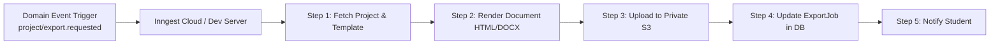

# Technical Architecture: Cevo

## 1. Architectural Philosophy & Overview

Cevo is engineered as a **Modular Monolith** built on the Next.js 16 App Router. It avoids premature distributed complexity, microservice overhead, or unnecessary container orchestration while strictly enforcing boundary separation between:
- Presentation and client components
- Server actions and route handlers
- Core domain business logic and financial accounting
- External third-party adapters (AI, Payments, Research, Storage)
- Background job processing

```
                                      ┌─────────────────────────────────────────────────────────┐
                                      │                   Client Layer (Browser)                │
                                      │  Next.js 16 App Router · React 19 · Tiptap · Tailwind 4 │
                                      └────────────────────────────┬────────────────────────────┘
                                                                   │ HTTPS (API / Server Actions)
                                                                   ▼
┌────────────────────────────────────────────────────────────────────────────────────────────────────────────────────────┐
│                                                 Cevo Modular Monolith                                                  │
│                                                                                                                        │
│  ┌─────────────────────────┐  ┌─────────────────────────┐  ┌─────────────────────────┐  ┌───────────────────────────┐  │
│  │   Security & Guard      │  │    Student Domain       │  │     Document Engine     │  │     Commercial Core       │  │
│  │  Better Auth · Arcjet   │  │  Onboarding · Projects  │  │  Tiptap JSON · Version  │  │  Credit Ledger · Wallet   │  │
│  │  RBAC · Validation Zod  │  │  Briefs · Outline Tree  │  │  Review · Template Match│  │  Fapshi Adapter · Webhook │  │
│  └────────────┬────────────┘  └────────────┬────────────┘  └────────────┬────────────┘  └─────────────┬─────────────┘  │
│               │                            │                            │                             │                │
│  ┌────────────┴────────────────────────────┴────────────────────────────┴─────────────────────────────┴─────────────┐  │
│  │                                          External Integration Adapters                                           │  │
│  │       OpenRouter (AI SDK)   ·   OpenAlex & Crossref (Research)   ·   Fapshi (Payments)   ·   S3 (Storage)        │  │
│  └──────────────────────────────────────────────────────┬───────────────────────────────────────────────────────────┘  │
│                                                         │                                                              │
│  ┌──────────────────────────────────────────────────────┴───────────────────────────────────────────────────────────┐  │
│  │                                              Data & Infrastructure Layer                                          │  │
│  │                 Prisma ORM (v8)   ·   PostgreSQL   ·   Inngest Background Orchestration                           │  │
│  └───────────────────────────────────────────────────────────────────────────────────────────────────────────────────┘  │
└────────────────────────────────────────────────────────────────────────────────────────────────────────────────────────┘
```

---

## 2. Core Application Modules

### 2.1 Identity & Security (`@/lib/auth`, `@/server/auth`)
- **Technology:** Better Auth with PostgreSQL adapter.
- **Responsibilities:** User identity, password hashing, session cookies, email verification tokens, and role-based access control (`STUDENT`, `ADMIN`, `SUPER_ADMIN`).
- **Protection Layer:** Arcjet for bot protection, brute-force mitigation, and per-user rate limiting on expensive AI endpoints.

### 2.2 Academic & Project Management (`@/server/projects`)
- **Responsibilities:**
  - Academic profile management (Institution, Department, Qualification).
  - 5-stage project creation wizard logic.
  - Conversational brief generation and structured outline formulation.
  - Ownership enforcement: Every database query strictly filters by `userId` to prevent Insecure Direct Object References (IDOR).

### 2.3 Document Workspace Engine (`@/server/documents`, `@/components/workspace`)
- **Technology:** Tiptap 2.x (ProseMirror core), custom extensions for citations and callouts.
- **Data Model:** Canonical document stored as structured JSON (ProseMirror node tree) per section, not as a single monolithic markdown or HTML string.
- **Autosave Pipeline:** Debounced client emitter (1.5s), optimistic UI state, server transaction, snapshotting on significant milestones.

### 2.4 Research & Verification Engine (`@/server/research`)
- **Integrations:** OpenAlex API, Crossref REST API, Semantic Scholar API.
- **Responsibilities:**
  - Multi-source search aggregation and deduplication by DOI.
  - Metadata hygiene and author array normalization.
  - Deterministic citation generation (APA 7 and Harvard) implemented in pure TypeScript without LLM dependency.
  - Verification state engine (`METADATA_VERIFIED`, `DOI_VERIFIED`, `REQUIRES_REVIEW`).

### 2.5 AI Orchestration Layer (`@/server/ai`)
- **Technology:** Vercel AI SDK (`ai` package) with OpenRouter provider.
- **Responsibilities:**
  - Model routing based on task complexity (fast/economical models for sentence rewrites; reasoning models for brief synthesis).
  - Strict Zod schema validation for structured outputs (`generateObject`).
  - Pre-execution context pruning: Ingests only relevant section and brief objectives, respecting token budget.
  - Telemetry: Records tokens, execution latency, estimated provider cost, and credits consumed into `AiUsage`.

### 2.6 Financial & Credit Core (`@/server/billing`)
- **Technology:** Fapshi Payment Gateway adapter, double-entry transactional ledger.
- **Ledger Invariant:** Every credit modification is recorded as an immutable `CreditLedger` entry within a PostgreSQL serializable transaction.
- **Payment Verification:** Webhook HMAC verification with backup scheduled pull-reconciliation.

### 2.7 Document Production & Export (`@/server/export`, `@/jobs/export`)
- **PDF Pipeline:** Headless browser rendering (Chromium via `@sparticuz/chromium` in serverless or local Puppeteer in container) executing HTML print styles with `@page` CSS rules.
- **DOCX Pipeline:** Structured OpenXML generation using `docx` package, mapping Tiptap nodes to native Word styles.
- **Execution:** Handled asynchronously via Inngest jobs to prevent HTTP timeout on serverless functions.

---

## 3. Technology Stack & Component Choices

| Layer | Selected Technology | Architecture Justification |
|---|---|---|
| **Framework** | Next.js 16.4 (App Router) | Turbopack compilation, React 19 Server Components, Server Actions for mutations, streaming responses for AI. |
| **Styling** | Tailwind CSS v4 | Next-generation CSS engine with `@theme inline` OKLCH color variables and instant rebuild times. |
| **Component Library** | shadcn/ui + Base UI | Unstyled, accessible primitives with zero runtime overhead, fully styled using Cevo brand tokens. |
| **Database & ORM** | PostgreSQL + Prisma (v8) | Type-safe migrations, relational integrity, foreign key cascades, and connection pooling. |
| **Authentication** | Better Auth | Native TypeScript auth engine supporting multi-tenant sessions, email verification, and plugin architecture. |
| **Rich Text Editor** | Tiptap / ProseMirror | Industry standard headless editor, customizable schema, structured JSON storage, real-time citation marks. |
| **AI Integration** | Vercel AI SDK + OpenRouter | Provider-agnostic model routing, structured object generation, standardized streaming protocol. |
| **Background Jobs** | Inngest | Durable execution, automatic retries with exponential backoff, step-level idempotency, zero Redis infrastructure maintenance. |
| **Payments** | Fapshi SDK & Webhook API | Leading payment aggregator for Cameroon supporting MTN Mobile Money and Orange Money in XAF. |
| **Object Storage** | S3-Compatible Cloud Storage | Private bucket storage with presigned URLs for project assets and generated exports. |
| **Security & Rate Limits** | Arcjet | Application-level firewall, rate limiting, and bot protection integrated into Next.js middleware. |

---

## 4. Background Job Processing (Inngest Architecture)

Background jobs are defined in `@/inngest/functions/` and served via `/api/inngest`:



### Registered Inngest Workflows
1. `file.process`: Virus scan, mime-type verification, and text extraction from uploaded PDF/DOCX guidelines.
2. `template.extract`: LLM-assisted structural guideline extraction from university syllabi with Zod schema output.
3. `project.export`: High-fidelity PDF/DOCX compilation.
4. `payment.reconcile`: Scheduled cron running every 15 minutes to verify pending Fapshi payments older than 10 minutes.
5. `ai.usage.aggregate`: Daily rollup of AI token consumption, provider costs, and credit margins.
6. `storage.cleanup`: Pruning expired temporary export files after 7 days.

---

## 5. Security & Isolation Architecture

1. **Multi-Tenant Ownership Verification:**
   - Every server action and route handler runs an authorization check:
     ```typescript
     const session = await auth.getSession();
     const project = await prisma.project.findFirstOrThrow({
       where: { id: projectId, userId: session.user.id }
     });
     ```
2. **Untrusted Input Sanitization:**
   - Tiptap JSON is validated against strict node/mark schemas to prevent stored XSS.
   - Uploaded files are served exclusively through short-lived presigned S3 URLs (`Expires: 900`).
3. **Database Financial Invariants:**
   - The user's `CreditWallet.balance` must equal the sum of verified ledger transactions.
   - Credit deduction uses atomic conditional updates:
     ```sql
     UPDATE "CreditWallet" 
     SET balance = balance - :cost 
     WHERE id = :walletId AND balance >= :cost;
     ```
     If the query returns zero affected rows, the transaction rolls back immediately with an `INSUFFICIENT_CREDITS` error.
