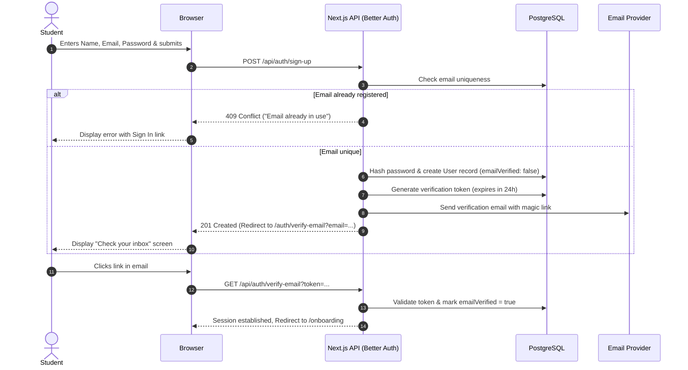
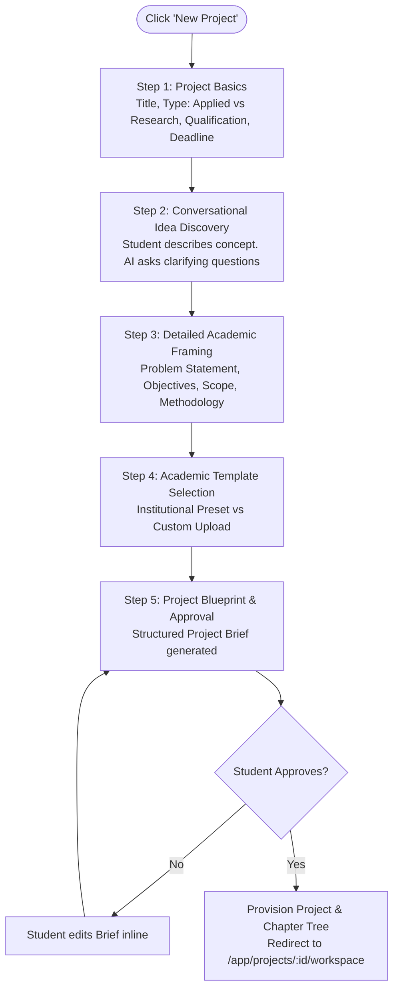
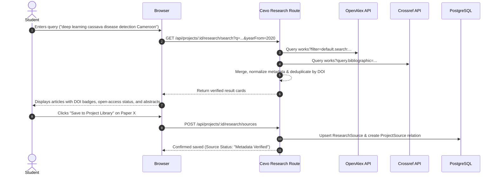
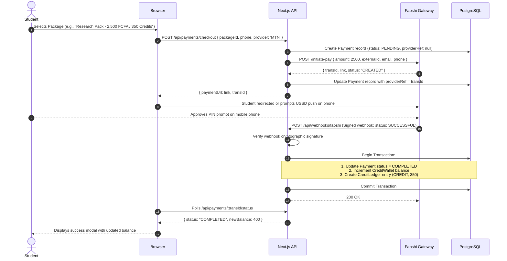
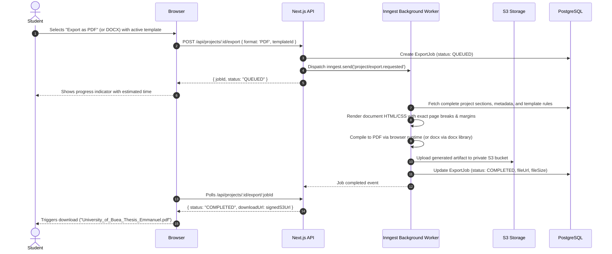

# User Flows: Cevo

## 1. Flow Overview

This document specifies the end-to-end user journeys for students, administrators, and system actors. Every flow details triggers, steps, validations, state transitions, edge cases, and error recovery mechanisms.

---

## 2. Student Authentication & Onboarding

### Flow 1.1: Registration & Email Verification


### Flow 1.2: Academic Onboarding
**Pre-condition:** User is authenticated and `StudentProfile.onboardingCompleted = false`.
1. **Step 1 - Personal Info:** First name, last name, preferred language (English / French), country (default: Cameroon).
2. **Step 2 - Academic Affiliation:**
   - Institution (Select from verified institutions, e.g., University of Buea, University of Yaounde I, PKFokam Institute of Excellence, or click "My institution is not listed").
   - If not listed: user enters institution name and country; system records as a pending suggestion.
   - Faculty / School (e.g., Faculty of Engineering and Technology).
   - Department (e.g., Computer Science).
   - Programme (e.g., B.Sc. Computer Science).
   - Qualification Level: `HND`, `BACHELORS`, `MASTERS`, `PHD`, `OTHER`.
   - Academic Session: (e.g., 2026/2027).
3. **Step 3 - Academic Preferences:** Preferred referencing style (`APA_7`, `HARVARD`), referral source.
4. **Completion:** Submits to server action `completeOnboarding`. System creates `StudentProfile` and `AcademicProfile`, sets `onboardingCompleted = true`, awards 50 starter welcome credits, and redirects to `/app`.

---

## 3. Project Creation & Intelligent Framing

### Flow 2.1: 5-Stage Project Creation Wizard (`/app/projects/new`)


1. **Step 1 - Basics:** Student enters working title, selects project type (`APPLIED_SOFTWARE` or `RESEARCH_ACADEMIC`), confirms qualification and programme.
2. **Step 2 - Conversational Idea Discovery:** 
   - Student enters 1-3 sentences about what they want to build or investigate.
   - AI evaluates clarity and asks 2-3 focused follow-up questions (e.g., "What specific software architecture or dataset do you intend to use?", "Who will test or benefit from this system?").
   - Student responds; AI confirms sufficient detail has been gathered.
3. **Step 3 - Detailed Academic Framing:**
   - AI drafts: Background, Problem Statement, General Aim, Specific Objectives (3-5 measurable bullets), Research Questions, Scope & Delimitation, Methodology, and Expected Outcomes.
   - Student can adjust any field directly.
4. **Step 4 - Template Selection:**
   - System recommends matching institutional template based on student's profile.
   - Student can accept, choose another institutional template, or upload their department's guideline PDF/DOCX.
5. **Step 5 - Blueprint Approval:**
   - Full Project Brief is presented with chapter structure, preliminary page requirements, and referencing rules.
   - Student clicks **"Approve & Initialize Workspace"**.
   - Server creates `Project`, `ProjectBrief`, `ProjectOutline`, and initial `Document` and `ProjectSection` records.

---

## 4. Document Workspace & Authoring

### Flow 3.1: 3-Panel Document Workspace Navigation
- **Left Panel (Document Tree):** Displays hierarchical structure:
  - Preliminary Pages: Cover Page, Declaration, Dedication, Acknowledgements, Abstract, Table of Contents, List of Figures, List of Tables.
  - Core Chapters: Chapter 1 (Introduction), Chapter 2 (Literature Review), Chapter 3 (System Analysis & Methodology), Chapter 4 (Design & Implementation), Chapter 5 (Testing & Conclusion).
  - Post-Matter: References, Appendices.
- Clicking any node loads that section into the central editor canvas without a full page reload.

### Flow 3.2: Robust Autosave Lifecycle
```
[User Types in Tiptap]
        │
        ▼
Status: "Unsaved Changes" (Orange indicator)
        │
        ├── Saves immediately to IndexedDB/LocalStorage (Offline Safety Net)
        │
        ▼ (Debounce timer: 1500ms)
Status: "Saving..." (Spinning indicator)
        │
        ▼ POST /api/projects/:id/sections/:sectionId/save
[Database Transaction / Prisma Update]
        │
        ├── Success ──► Status: "Saved" (Green checkmark, timestamp updated)
        │
        └── Failure ──► Status: "Save Failed - Click to Retry" (Red alert)
                        (Local buffer retained, auto-retry on network reconnect)
```

### Flow 3.3: Contextual AI Assistant Interaction
1. Student selects a paragraph in the editor or clicks the AI Assistant panel.
2. Student selects an action:
   - "Improve academic tone"
   - "Expand with theoretical rationale"
   - "Check consistency against Chapter 1 Objectives"
   - "Simplify sentence structure"
   - Freeform prompt.
3. System verifies student has sufficient credits:
   - If insufficient: Prompts top-up dialog.
   - If sufficient: Shows estimated credit cost (e.g., 5 Credits) and requests confirmation.
4. System dispatches request to OpenRouter with scoped context:
   - Section title + Student's selected text + Project Brief summary (Aim & Objectives).
   - Does NOT send the entire 50-page document.
5. Streamed response renders in a side-by-side **Diff Preview**:
   - Red highlights for deletions, green highlights for additions.
6. Student choices:
   - **Accept Replacement:** Replaces text in Tiptap canvas.
   - **Insert Below:** Appends as new paragraph.
   - **Reject / Discard:** Clears preview without document changes.
7. Credit ledger records consumption.

---

## 5. Verified Academic Research & Citations

### Flow 4.1: Research Discovery & Reference Management


### Flow 4.2: Deterministic Citation Insertion
1. In the Tiptap editor, student types `@cite` or clicks the "Insert Citation" toolbar button.
2. Quick-search modal displays the student's saved project reference library.
3. Student selects the reference (e.g., *Nkem et al., 2024*).
4. System formats the in-text citation deterministically according to the project's active style:
   - Parenthetical: `(Nkem et al., 2024)`
   - Narrative: `Nkem et al. (2024)`
5. Tiptap inserts an immutable citation inline mark with `data-source-id="xyz"`.
6. System automatically syncs the "References" chapter section at the end of the document, generating the full bibliographic entry in APA 7 or Harvard format.

---

## 6. Credit Purchases & Mobile Money Payments

### Flow 5.1: Prepaid Top-Up via Fapshi (MTN MoMo & Orange Money)


### Flow 5.2: Reconciliation & Edge-Case Recovery
- **Dropped Webhook Protection:** If the user returns from payment but webhook hasn't arrived, the client calls `/api/payments/:id/verify`. Server directly queries Fapshi's status endpoint `/payment-status/:transId`.
- **Double Credit Prevention:** Handled by a database unique constraint on `CreditLedger.referenceId` (Payment ID). Attempts to credit twice fail idempotently.
- **Failed Payment:** Payment marked `FAILED`. Wallet balance untouched. User notified with clear reason (e.g., "Insufficient mobile money funds" or "Transaction timed out").

---

## 7. Document Review & Multi-Format Export

### Flow 6.1: Pre-Submission Academic Review
1. Student navigates to `/app/projects/[projectId]/review`.
2. Student clicks "Run Academic Review".
3. System runs local deterministic heuristics and structural checks:
   - Mandatory chapters presence check (Chapters 1 through 5).
   - Preliminary pages completeness (Abstract word count, Declaration present).
   - In-text citations versus References list reconciliation (flags orphaned citations or uncited references).
   - Word count and heading hierarchy consistency.
4. System returns prioritized findings:
   - **Critical (Red):** "Chapter 1 has 4 specific objectives, but Chapter 5 only discusses outcomes for 2."
   - **Warning (Yellow):** "Citation (Fon et al., 2021) in Chapter 2 is missing from the References list."
   - **Recommendation (Blue):** "Abstract exceeds recommended 300 words (currently 342 words)."
5. Each finding links directly to the specific chapter and paragraph in the workspace.

### Flow 6.2: High-Fidelity PDF and DOCX Export


---

## 8. Administrative Operations

### Flow 7.1: Template Guideline Ingestion & Publishing
1. Admin logs into `/admin/templates` and clicks "New Template".
2. Admin uploads a university guideline document (PDF or DOCX).
3. System triggers background extraction job via Inngest:
   - Extracts page setup (A4, margins: Top 2.5cm, Bottom 2.5cm, Left 3.5cm binding, Right 2.0cm).
   - Extracts font rules (Body: Times New Roman 12pt, 1.5 line spacing; Heading 1: 16pt Bold uppercase).
   - Extracts required preliminary sequence.
4. Admin reviews extracted schema at `/admin/template-review/:id`.
5. Admin adjusts any misidentified parameters and clicks "Publish Version 1.0".
6. Template becomes immediately available in the student project creation wizard. Existing projects continue using their locked snapshot version to prevent unintended reformatting.
